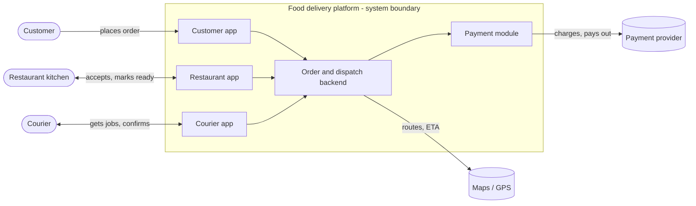
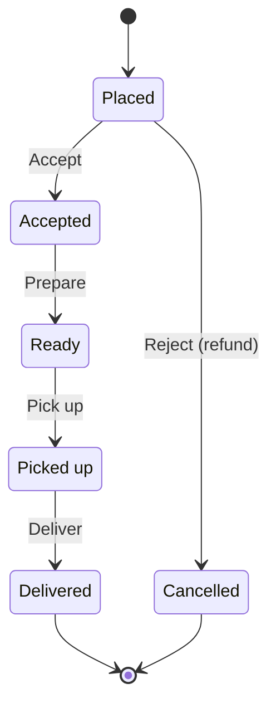
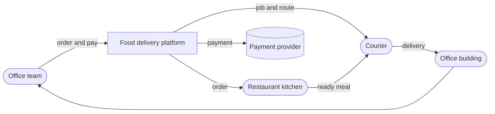

# System Model: Online Food Delivery

## 0. Selected System

**System:** Online food delivery platform (e.g., Wolt / Bolt Food)

---

## 1. System Boundary and Purpose

### Purpose

Deliver a ready-made meal from a restaurant to a customer's location quickly,
without the customer leaving home and without the restaurant needing its own delivery fleet.

### Boundary

| Inside the boundary (the system) | Outside the boundary (environment) |
|---|---|
| Customer app | Customer |
| Restaurant app | Restaurant kitchen and staff |
| Courier app | Couriers (as people) |
| Order and dispatch backend | Payment providers (banks, card networks) |
| Payment module | Maps / GPS services |
| | Road network, weather, traffic |

---

## 2. Components

| # | Component | Responsibility |
|---|---|---|
| 1 | **Customer app** | Browse menus, place and pay for orders, track delivery |
| 2 | **Restaurant app** | Receive orders, accept or reject them, mark them ready |
| 3 | **Courier app** | Receive delivery jobs, navigate, confirm pickup and drop-off |
| 4 | **Order and dispatch backend** | Manage order states, match orders to nearby couriers |
| 5 | **Payment module** | Charge the customer, split money between restaurant, courier and platform |

---

## 3. Process Object, States and Operations

### Process object

**The food order** - the thing the system transforms from an intent into a delivered meal.

### States

- **Initial state - Placed:** the customer has paid, but no food exists yet.
- **Final state - Delivered:** the food is in the customer's hands.

### Operations

| # | Operation | Performed by | Transition |
|---|---|---|---|
| 1 | **Accept** | Restaurant | Placed → Accepted |
| 2 | **Prepare** | Restaurant kitchen | Accepted → Ready |
| 3 | **Pick up** | Courier | Ready → Picked up |
| 4 | **Deliver** | Courier | Picked up → Delivered |

Alternative path: if the restaurant cannot fulfil the order, it is **rejected** and the customer is refunded (Placed → Cancelled).

---

## 4. Solution Configuration

### Scenario: team lunch at the office

Five colleagues want lunch from one restaurant without leaving work.

### Elements of the configuration

- Colleagues' phones with the customer app
- The food delivery platform
- The restaurant kitchen
- A courier with a bike or car
- The payment provider
- Maps / GPS
- The office building (delivery destination)

The platform alone produces nothing - value appears only when the kitchen, the courier and the payment provider are connected through it.

---

## 5. Stakeholder Value

| Stakeholder | Value they get |
|---|---|
| **Customer** | Saves time and effort; wide choice of restaurants; predictable delivery time with live tracking; cashless payment |
| **Restaurant** | Reaches customers beyond walk-in distance; more orders without extra seating or its own delivery staff (in exchange for the platform's commission) |

