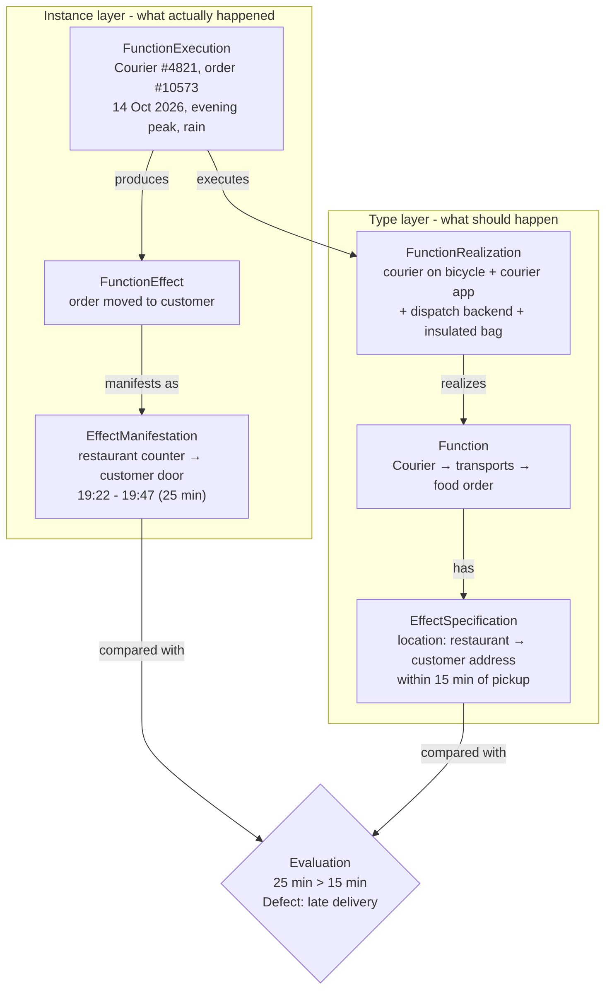

# Function Graph: Online Food Delivery

**System:** Online food delivery platform (e.g., Wolt / Bolt Food)
**Function:** Transport the food order to the customer

The graph separates two layers:

- **Type layer** (what *should* happen): Function, EffectSpecification, FunctionRealization
- **Instance layer** (what *actually* happened): FunctionExecution, FunctionEffect, EffectManifestation

---

## 1. Function

| Element | Value |
|---|---|
| **Carrier role** | Courier |
| **Action** | Transports |
| **Target role** | Food order |
| **EffectSpecification** | The food order's location changes from the restaurant pickup point to the customer's delivery address within 15 minutes of pickup |

Function statement: **Courier → transports → food order**

---

## 2. Expected Manifestation

| Element | Value |
|---|---|
| **Parameter** | Location of the food order (with delivery time as a constraint) |
| **Change or preservation** | Change |
| **Desired state** | Food order is at the customer's delivery address, handed over ≤ 15 minutes after pickup |

---

## 3. FunctionRealization

**Implementing configuration:** Courier delivery configuration

| SystemComponent | Role in the realization |
|---|---|
| Courier (person) on a bicycle | Physically moves the order |
| Courier app | Receives the job, shows the route, confirms pickup and drop-off |
| Order and dispatch backend | Assigns the courier and calculates the route and ETA |
| Insulated delivery bag | Holds the order during transport |

---

## 4. FunctionExecution

| Element | Value |
|---|---|
| **Actual carrier** | Courier #4821, on a bicycle |
| **Actual target** | Order #10573 (2x pizzas, 1x large coke) |
| **Context** | Weekday evening peak; rain; the courier was also assigned a second order on the way (batched delivery) |
| **Time** | 14 October 2026, pickup at 19:22 |

---

## 5. FunctionEffect and EffectManifestation

**FunctionEffect:** The food order was moved from the restaurant to the customer's address.

**EffectManifestation:**

| Element | Value |
|---|---|
| **Parameter** | Location of the food order |
| **Initial state** | At the restaurant pickup counter |
| **Final state** | Handed over at the customer's door |
| **TimeInterval** | 19:22 - 19:47 (25 minutes) |

---

## 6. Evaluation

| Criterion | Specified | Actual | Result |
|---|---|---|---|
| Final location | Customer's delivery address | Customer's delivery address | ✅ Met |
| Delivery time after pickup | ≤ 15 min | 25 min | ❌ Not met |

**Result:** The function was performed - the order reached the right place - but the effect does not fully match the EffectSpecification.

**Defect:** Late delivery, 10 minutes over the specified limit. This is a performance (time) defect, not a functional one.

**Likely cause:** The dispatch backend batched a second order onto the same courier during peak time, which added a detour. Rain slowed the bicycle further.

**Possible improvement:** Disable order batching when the estimated added time pushes the first order over its delivery limit.

---

## Function Graph

