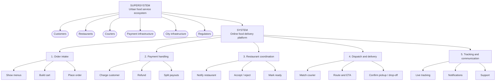

# System Hierarchy: Online Food Delivery

## 1. System

**System:** Online food delivery platform (e.g., Wolt / Bolt Food)

**Purpose:** Deliver a ready-made meal from a restaurant to a customer's location quickly, connecting customers, restaurants and couriers through one platform.

---

## 2. Supersystem

**Supersystem:** The urban food service ecosystem - everything in a city that gets prepared food from producers to consumers.

The platform is one part of it. Other parts of the supersystem:

| Supersystem element | Relation to the platform |
|---|---|
| **Customers** | Create demand; place and pay for orders |
| **Restaurants** | Supply the food; the platform depends on them for anything to deliver |
| **Couriers** | Supply the transport capacity |
| **Payment infrastructure** (banks, card networks) | Moves the money between all parties |
| **City infrastructure** (roads, mobile network, GPS) | Makes routing and real-time coordination possible |
| **Regulators** (food safety, labour, tax authorities) | Set the rules the platform and its partners must follow |
| **Alternative channels** (dine-in, takeaway, restaurants' own delivery, competing platforms) | Satisfy the same need; competition for the platform |

The platform produces no food and owns no vehicles. Its value comes entirely from coordinating other elements of the supersystem.

---

## 3. Breakdown by Functional Units

The system is decomposed into what it **does**, not what it is built from.

| # | Functional unit | Sub-functions |
|---|---|---|
| 1 | **Order intake** | Show restaurants and menus · build the cart · place the order |
| 2 | **Payment handling** | Charge the customer · issue refunds · split payouts between restaurant, courier and platform |
| 3 | **Restaurant coordination** | Notify the restaurant · accept or reject the order · mark the order ready |
| 4 | **Dispatch and delivery** | Match the order to a courier · calculate route and ETA · confirm pickup and drop-off |
| 5 | **Tracking and communication** | Live order tracking · status notifications · customer support |

For reference, the functional unit from Task 2 ("Courier transports the food order") belongs to **unit 4, Dispatch and delivery**.

---

## Hierarchy Diagram

**Levels:**

1. **Supersystem**: urban food service ecosystem
2. **System**: online food delivery platform
3. **Subsystems**: five functional units
4. **Elements**: sub-functions within each unit

