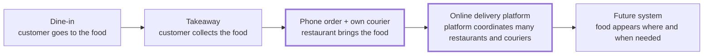
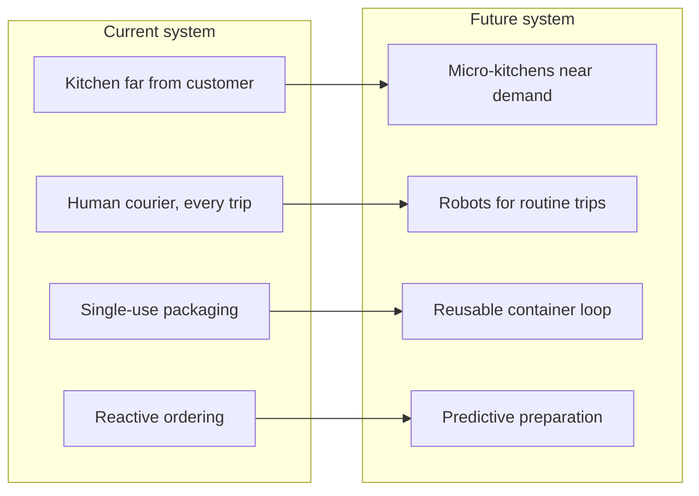

# System Evolution: Online Food Delivery

## 1. System Under Analysis

**System:** Online food delivery platform (e.g., Wolt / Bolt Food)

**Main function:** Deliver a ready-made meal from a restaurant to a customer's location.

---

## 2. Preceding System

**Preceding system:** Phone ordering with the restaurant's own delivery

The customer finds a restaurant's phone number (flyer, menu, directory), calls, dictates the order, and a courier employed by that restaurant brings the food and collects cash at the door.

### Evolution line

At each step, more of the work moves away from the customer and into the system.

---

## 3. Problems Solved by the Current System

| # | Problem in the preceding system | How the platform solves it |
|---|---|---|
| 1 | Only restaurants with their own couriers could deliver | Shared courier pool lets any restaurant deliver |
| 2 | Choice limited to the menus/flyers the customer had at hand | All nearby restaurants and menus in one app |
| 3 | Orders misheard or mistyped over the phone | Customer builds the order themselves; the restaurant receives it as structured data |
| 4 | No visibility after hanging up - "where is my food?" | Live order status and courier tracking with an ETA |
| 5 | Cash payment, change problems at the door | In-app cashless payment |
| 6 | No way to judge quality before ordering | Ratings, reviews and photos |
| 7 | Restaurant carries the cost of idle couriers in quiet hours | Couriers are shared and paid per delivery |

---

## 4. Problems Not Solved by the Current System

| # | Unsolved problem | Explanation |
|---|---|---|
| 1 | **Food quality loss in transit** | Food cools down, gets soggy or spills; the meal is cooked for eating at a table, not for a 20–30 minute trip |
| 2 | **Delivery time at peak hours** | Demand spikes at lunch and dinner; batching orders saves couriers but delays customers (see the Task 2 defect) |
| 3 | **High cost for all sides** | Restaurants pay a commission, customers pay delivery and service fees, couriers earn per trip |
| 4 | **Courier working conditions** | Gig work with unstable income, weather exposure and traffic risk |
| 5 | **Packaging waste** | Every order produces single-use containers, bags and cutlery |
| 6 | **Traffic and emissions** | Many small trips by car or scooter for small loads |
| 7 | **"Last 50 metres"** | Finding the right building, entrance or apartment, and contacting the customer at the door |
| 8 | **Restaurant dependence on the platform** | The platform owns the customer relationship and data; restaurants lose direct contact with their customers |

---

## 5. Image of the Future System

### Ideal Final Result (TRIZ)

> The customer gets a hot, fresh meal exactly when and where they want it, with no waiting, no waste and no extra cost - while the delivery system itself is barely noticeable.

The ideal is that the *function* (meal at the customer) is fully performed while the *system* (couriers, vehicles, packaging, fees) tends toward zero.

### Characteristics of the future system

| Unsolved problem | Direction in the future system |
|---|---|
| Food quality loss | Food finished close to the customer (micro-kitchens near demand clusters) or active containers that keep or bring food to the right temperature |
| Peak-time delays | Demand prediction - preparation starts before the order based on habits and patterns; dispatch plans around peaks instead of reacting |
| High cost | Automation reduces per-delivery cost; shorter distances from local micro-kitchens |
| Courier conditions | Robots and drones take over routine short trips; humans handle complex deliveries with fairer, more stable pay |
| Packaging waste | Reusable, tracked containers returned through the same delivery network |
| Traffic and emissions | Small electric robots and bikes on short routes; consolidated deliveries to building lockers |
| Last 50 metres | Smart lockers or delivery points in buildings; precise indoor location |
| Restaurant dependence | Open standards that let restaurants keep their customer relationships across platforms |

### Trends of evolution visible in this image

- **Increasing ideality**: more benefit with fewer costs and harms
- **Decreasing human involvement**: automation of routine transport
- **Transition to the supersystem**: delivery merges into building infrastructure (lockers, reusable container loops)
- **Shorter distances**: production moves closer to consumption

