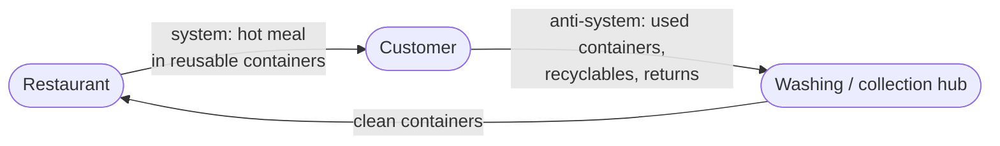

# Anti-System: Online Food Delivery

## 1. System

**System:** Online food delivery platform (e.g., Wolt / Bolt Food), specifically its delivery subsystem (courier + courier app + dispatch backend).

---

## 2. Function and Action

| Element | Value |
|---|---|
| **Function** | Deliver a ready-made meal to the customer |
| **Action** | Courier **moves** the food order **from the restaurant to the customer** |
| **Direction of flow** | Restaurant → customer |

After the drop-off the courier travels to the next pickup **empty**, so on every trip the delivery network moves goods in one direction only.

---

## 3. Opposite Action

| Element | Value |
|---|---|
| **Opposite action** | Courier **moves** items **from the customer to the restaurant / a hub** |
| **Direction of flow** | Customer → restaurant / hub |

Instead of *delivering to* the customer, the system *collects from* the customer.

---

## 4. Useful Anti-System

**Anti-system:** A reverse logistics (collection) service - couriers pick up items from customers' homes.

What is worth collecting from a food delivery customer:

| Item collected | Why it is useful |
|---|---|
| **Reusable food containers** | Makes reusable packaging practical, so customers don't have to return containers themselves |
| **Recyclables and packaging** | Bags, glass bottles and deposit-return packaging go back into the recycling loop |
| **Online shopping returns** | Small parcels go back to a hub without a trip to a parcel locker |

Today these services exist separately (or not at all) and each needs its own vehicles and trips.

---

## 5. Merging the System and the Anti-System

### Merged system: closed-loop delivery

The same courier, on the same trip, **delivers the meal and collects returnable items** - reusable containers first of all.

### What the merged system gains

| New property | Explanation |
|---|---|
| **No empty return trips** | The courier carries something useful in both directions |
| **Reusable packaging becomes viable** | The biggest obstacle to reusable containers - getting them back - is solved by the existing delivery network |
| **Less waste** | Fewer single-use containers per order (an unsolved problem from Task 4) |
| **Lower cost per trip** | One trip performs two services; collection can be paid for with deposits or small fees |
| **New service for the platform** | Collection of returns and recyclables using the same couriers and the same app |

### Contradiction and how it is resolved

Merging creates a conflict: **fresh food and used containers must not touch** (hygiene).

| TRIZ separation principle | Resolution |
|---|---|
| **Separation in space** | Delivery bag with a sealed, separate compartment for collected items |
| **Separation in time** | Food is delivered first; collected items go in the bag only after the meal is handed over |
| **Separation by condition** | Customer rinses and closes containers in a return bag before handover |

### Result

The initial system moves meals **to** the customer; the anti-system moves items **away** from the customer. Combined, they form a **two-way, closed loop** where the delivery network serves both directions on every trip.

