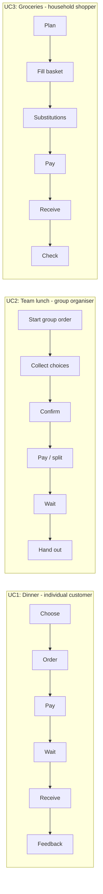

# Product Microstages: Online Food Delivery App

## 1. Product

**Product:** Online food delivery app (e.g., Wolt / Bolt Food)

**Why it is multifunctional:** One app covers several different jobs - restaurant meals, group orders, and grocery delivery - each with its own user role and flow.

---

## 2–5. Use Cases, Roles, Microstages and Useful Functions

Each use case is written in the **Jobs To Be Done** format:
*When [situation], I want to [motivation], so I can [expected outcome].*

Useful functions are written as **product → action → object**.

---

### Use Case 1: Dinner after a long day

**JTBD:** *When* I come home tired after work, *I want to* get a hot dinner without cooking or going out, *so I can* eat well and rest for the evening.

**User's role:** Individual customer (orders and eats)

| # | Microstage | What the user does | Useful function |
|---|---|---|---|
| 1 | Choose | Browses nearby restaurants | App **shows** restaurants by delivery time, rating and price |
| 2 | Order | Picks dishes and customises them | App **records** the order with options (e.g., no onions) |
| 3 | Pay | Confirms checkout | App **charges** the saved card |
| 4 | Wait | Checks progress | App **displays** order status and courier location |
| 5 | Receive | Meets the courier at the door | App **notifies** the user when the courier arrives |
| 6 | Give feedback | Rates the meal and delivery | App **collects** the rating for the restaurant and courier |

---

### Use Case 2: Team lunch at the office

**JTBD:** *When* my team wants lunch together without leaving work, *I want to* collect everyone's choices into one order, *so I can* get all meals delivered at once without chasing people or splitting bills by hand.

**User's role:** Group organiser (coordinates the order for others)

| # | Microstage | What the user does | Useful function |
|---|---|---|---|
| 1 | Start group order | Creates a group order and shares the link | App **generates** a shareable group order link |
| 2 | Collect choices | Colleagues add their own dishes | App **merges** individual choices into one cart |
| 3 | Confirm | Checks the full order and a deadline | App **locks** the order after the set deadline |
| 4 | Pay / split | Pays or splits the cost | App **divides** the bill between participants |
| 5 | Wait | Watches the single delivery | App **tracks** one delivery for the whole group |
| 6 | Hand out | Distributes meals at the office | App **labels** each item with the colleague's name |

---

### Use Case 3: Weekly groceries

**JTBD:** *When* the fridge is empty and I have no time to go to the shop, *I want to* order my usual groceries quickly, *so I can* restock the household without spending an hour in a store.

**User's role:** Household shopper (buys for the household)

| # | Microstage | What the user does | Useful function |
|---|---|---|---|
| 1 | Plan | Opens previous grocery orders | App **suggests** a repeat of the usual basket |
| 2 | Fill the basket | Adds and removes products | App **checks** product availability in the store |
| 3 | Handle substitutions | Approves replacements for missing items | App **proposes** similar products for out-of-stock items |
| 4 | Pay | Confirms checkout | App **charges** the final amount, adjusted for substitutions |
| 5 | Receive | Takes the bags at the door | App **schedules** delivery to the chosen time slot |
| 6 | Check | Reports missing or damaged items | App **refunds** missing or damaged items |

---

## Overview

**Observation:** All three use cases share the core microstages (choose → pay → wait → receive), but each role adds its own specific microstages - coordination for the group organiser, substitutions for the grocery shopper. These role-specific microstages are where the product's extra useful functions appear.

