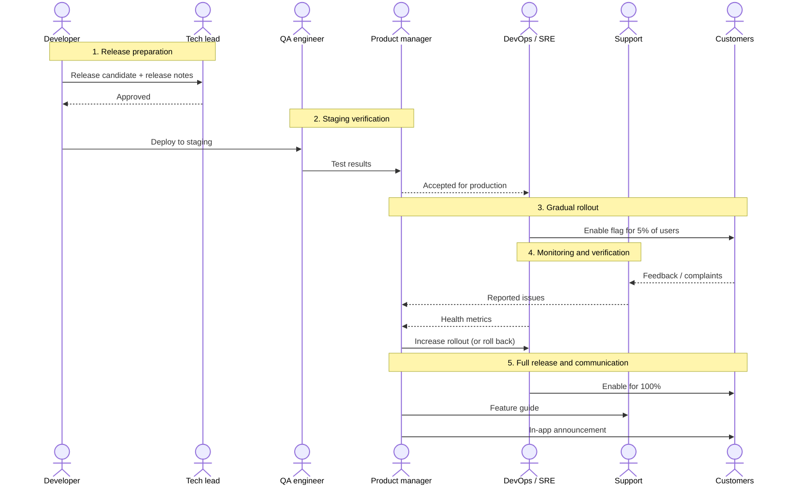

# SDLC Stage Analysis: Deployment and Release

## 1. Selected SDLC Stage

**Stage:** Deployment and Release

**Context:** Releasing the **group order** feature (Use Case 2 from Task 6) of the online food delivery app to production.

**Goal of the stage:** Move a tested feature from the development environment to real users safely - without breaking existing ordering, and with the ability to stop or roll back quickly.

**Input:** Feature code merged to the main branch, passed automated tests.
**Output:** Feature available to all users, monitored and documented.

---

## 2. Microstages

| # | Microstage | Purpose |
|---|---|---|
| 1 | **Release preparation** | Build a release candidate and document what changes |
| 2 | **Staging verification** | Confirm the feature works in a production-like environment |
| 3 | **Gradual rollout** | Release to a small share of users first, behind a feature flag |
| 4 | **Monitoring and verification** | Watch metrics and errors to decide whether it is safe to continue |
| 5 | **Full release and communication** | Turn the feature on for everyone and inform support and partners |

---

## 3. Interaction Scenarios

### Microstage 1: Release preparation

| Stakeholder | Role in this microstage |
|---|---|
| **Developer** | Author of the change; prepares the release |
| **Tech lead** | Reviewer and approver of the release |
| **CI/CD pipeline** (system) | Builds and packages the release candidate |

**Scenario:**

1. The developer tags the main branch as a release candidate and writes release notes (what changed, migration steps, feature flag name).
2. The CI/CD pipeline builds the app and backend, runs the automated test suite and produces versioned artifacts.
3. The tech lead reviews the release notes and the database migration plan, and approves the release candidate.

**Outcome:** An approved, versioned release candidate with documented changes.

---

### Microstage 2: Staging verification

| Stakeholder | Role in this microstage |
|---|---|
| **QA engineer** | Verifier; tests the feature end to end |
| **Product manager** | Acceptance owner; confirms the feature matches the requirements |
| **Developer** | Fixer; resolves any defects found |

**Scenario:**

1. The release candidate is deployed to the staging environment.
2. The QA engineer runs end-to-end scenarios: create a group order, share the link, add items from several accounts, lock at the deadline, split the bill.
3. The product manager walks through the flow and checks it against the acceptance criteria.
4. If a defect is found, the developer fixes it and a new release candidate goes back to microstage 1.

**Outcome:** QA sign-off and product acceptance - the release candidate is cleared for production.

---

### Microstage 3: Gradual rollout

| Stakeholder | Role in this microstage |
|---|---|
| **DevOps / SRE engineer** | Operator; deploys to production and manages the feature flag |
| **Product manager** | Decision maker; chooses rollout scope |
| **Early users** (customers) | Real-world testers; use the feature first |

**Scenario:**

1. The DevOps engineer deploys the release to production with the group order feature **turned off** by its feature flag.
2. The product manager decides the first audience: 5% of users in one city.
3. The DevOps engineer enables the flag for that audience.
4. Early users see the "Start group order" button and use it in real orders.

**Outcome:** The feature runs in production for a small, controlled group of users.

---

### Microstage 4: Monitoring and verification

| Stakeholder | Role in this microstage |
|---|---|
| **DevOps / SRE engineer** | Observer; watches system health |
| **Developer** | On-call responder; investigates errors |
| **Product manager** | Analyst; checks usage and business metrics |
| **Customer support agent** | Feedback channel; reports user complaints |

**Scenario:**

1. The DevOps engineer watches dashboards: error rate, response time and payment failures for group orders compared with normal orders.
2. The developer on call checks error logs and alerts for the new feature.
3. The product manager checks adoption: how many group orders are created and completed.
4. The customer support agent flags any user complaints tagged "group order".
5. **Decision point:**
   - Metrics are healthy -> increase the rollout (5% → 25% → 50%) and repeat.
   - Problems found → the DevOps engineer turns the flag off (instant rollback) and the developer fixes the issue.

**Outcome:** Evidence-based go / no-go decision for each rollout step.

---

### Microstage 5: Full release and communication

| Stakeholder | Role in this microstage |
|---|---|
| **Product manager** | Release owner; announces the feature |
| **DevOps / SRE engineer** | Operator; enables the feature for 100% of users |
| **Customer support team** | Receivers of knowledge; prepare to answer questions |
| **Restaurant partner manager** | Communicator; informs restaurants about larger group orders |
| **All customers** | End users; get the new feature |

**Scenario:**

1. The DevOps engineer enables the feature flag for all users.
2. The product manager publishes an in-app announcement and updates the help centre.
3. The customer support team receives a short guide on group orders and common issues (e.g., splitting payments).
4. The restaurant partner manager informs restaurants that they may receive larger single orders at lunch time.
5. After a stable period, the developer removes the feature flag from the code.

**Outcome:** The feature is live for everyone, supported and documented; the release is closed.

---

## Interaction Overview

