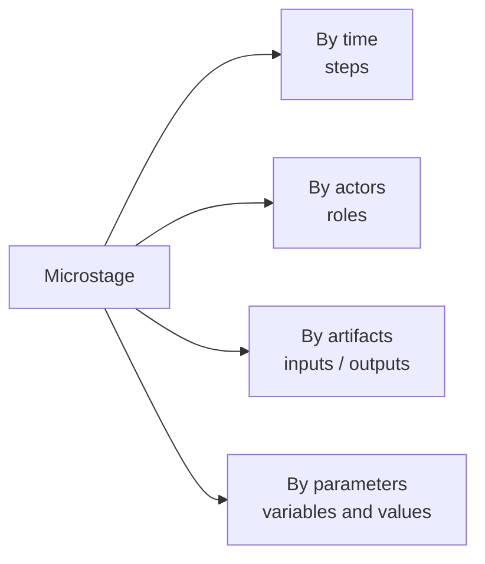

# Product Variable Decomposition: Group Order Feature

## 1. Selected Microstages

Product: Online food delivery app - **group order** feature (Use Case 2, Task 6).

One microstage from each of three different SDLC stages:

| # | SDLC stage | Microstage |
|---|---|---|
| A | Requirements | **Defining acceptance criteria** for group orders |
| B | Design | **Designing the group cart** (data model and API) |
| C | Deployment | **Gradual rollout** behind a feature flag (Task 7, microstage 3) |

## 2. Decompositions

Each microstage is decomposed along four different variables:

| Decomposition | Question it answers |
|---|---|
| **By time** | In what order do things happen? |
| **By actors** | Who takes part, and what does each do? |
| **By artifacts** | What goes in, and what comes out? |
| **By parameters** | Which variables can be changed, and what are their options? |

---

## A. Requirements - Defining acceptance criteria

### By time

1. Collect needs from users and support tickets ("we want to order together at work")
2. Write user stories for the organiser and participants
3. Write acceptance criteria for each story
4. Review with the team and agree

### By actors

| Actor | Contribution |
|---|---|
| Product manager | Writes stories and acceptance criteria |
| UX researcher | Brings user interview findings |
| Developer | Checks technical feasibility |
| QA engineer | Checks that each criterion is testable |

### By artifacts

| Input | Output |
|---|---|
| User interviews, support tickets, competitor analysis | User stories, acceptance criteria, list of out-of-scope items |

### By parameters

| Parameter | Possible values | Chosen value |
|---|---|---|
| Max participants in a group | 5 / 10 / 20 / unlimited | 20 |
| Who can join | Anyone with the link / invited contacts only | Anyone with the link |
| Order deadline | Fixed by organiser / none | Set by organiser |
| Payment mode | Organiser pays all / each pays own / both | Both |
| Restaurants per group order | One / several | One |

---

## B. Design - Designing the group cart

### By time

1. Model the entities: group order, participant, cart item
2. Define states of the group order (Open -> Locked -> Placed)
3. Design the API endpoints
4. Decide how to handle several people editing the cart at once
5. Review the design with the team

### By actors

| Actor | Contribution |
|---|---|
| Backend developer | Data model, API, concurrency handling |
| Mobile developer | Checks the API fits the app screens |
| Tech lead / architect | Reviews the design and trade-offs |
| Payments team | Confirms how bill splitting fits the payment module |

### By artifacts

| Input | Output |
|---|---|
| Acceptance criteria (from A), existing order and payment APIs | Data model diagram, state diagram, API specification, design decision record |

### By parameters

| Parameter | Possible values | Chosen value |
|---|---|---|
| Cart update method | Polling / WebSockets / push notifications | WebSockets |
| Concurrent edits | Last write wins / per-participant item lists / locking | Per-participant item lists |
| Group order storage | Separate service / extension of order service | Extension of order service |
| Link lifetime | Until deadline / 24 hours / manual close | Until deadline |
| API style | REST / GraphQL | REST (matches existing APIs) |

---

## C. Deployment - Gradual rollout

### By time

1. Deploy to production with the flag off
2. Enable for 5% of users in one city
3. Monitor for an agreed period
4. Increase to 25% -> 50% -> 100%, or roll back

### By actors

| Actor | Contribution |
|---|---|
| DevOps / SRE engineer | Deploys and changes the feature flag |
| Product manager | Decides scope of each rollout step |
| Developer on call | Responds to errors |
| Early users | Use the feature in real conditions |

### By artifacts

| Input | Output |
|---|---|
| Approved release candidate, rollout plan, dashboards | Production deployment, rollout log, metrics report, go / no-go decisions |

### By parameters

| Parameter | Possible values | Chosen value |
|---|---|---|
| Share of users | 1% / 5% / 25% / 50% / 100% | Start at 5% |
| Audience segment | City / platform (iOS, Android) / new vs. returning users / employees only | One city, all platforms |
| Time per step | Hours / 1 day / 1 week | 2 days |
| Success threshold | Error rate, payment failure rate, completion rate | Error rate no higher than normal orders |
| Rollback method | Turn off flag / redeploy previous version | Turn off flag |

---

## Observation

- **By time, actors and artifacts** describe *how the microstage is carried out*.
- **By parameters** shows *where the product can vary* - each parameter is a design decision with alternatives.

The parameter decomposition also links the stages: the parameters chosen in **A** (max participants, payment mode) constrain the parameters in **B** (data model, payment integration), and the result of **B** determines what can be safely varied in **C** (rollout scope and rollback method).

