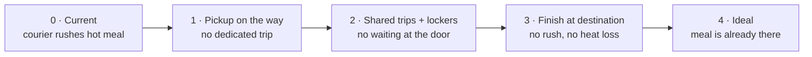

# Ideal System: Food Delivery

## 1. System for Analysis

**System:** Delivery subsystem of the online food delivery platform - courier, courier app, dispatch backend, insulated bag (the FunctionRealization from Task 2).

---

## 2. Useful Function

### Function as performed today

**Courier -> transports -> food order** (from the restaurant to the customer)

### The real useful function

Transport is only a means. What the customer actually needs is:

> **The customer has a hot, fresh meal at the time and place they want it.**

Moving the food is just how the current system achieves this. Separating the *need* from the *means* opens up solutions that don't involve transport at all.

### Costs and harms of the current system

| Costs | Harms |
|---|---|
| Courier labour | Food cools and loses quality in transit |
| Vehicles and fuel | Waiting time, longer at peak hours |
| Delivery and service fees | Packaging waste |
| Dispatch infrastructure | Traffic and emissions |
| | Risk to couriers on the road |

### Ideality

```
Ideality = Useful functions / (Costs + Harms)
```

The current system delivers the function, but with high costs and many harms, so its ideality is low.

---

## 3. Ideal System for the Function

### Ideal Final Result (IFR)

> The meal **is hot and ready at the customer's place by itself**, at the moment they want it - with no courier, no vehicle, no waiting and no waste.

The system disappears; the function remains.

### Resources already available

The ideal system must reach the function using resources that **already exist** rather than adding new ones.

| Resource | Where it is | How it can perform part of the function |
|---|---|---|
| **Customer's own oven / microwave** | In the customer's home | Heats the meal at the destination, so food does not need to stay hot in transit |
| **The customer's own trips** | Commute, walk home | The customer passes the meal on their way, so no separate trip is needed |
| **People already going to the same building** | Neighbours, other deliveries, parcel couriers | Carry the meal along on a trip that is already happening |
| **Time before the order** | Order history, habits | Lets the meal be prepared and moved in advance, when there is no rush |
| **Building infrastructure** | Parcel lockers, shared fridges | Stores the meal until the customer is ready |

### Approaching the ideal

Each step removes cost or harm while keeping the function.

| Level | Solution | What disappears |
|---|---|---|
| 0 - Current | Courier rushes a hot meal from restaurant to door | - |
| 1 | **Pickup on the way**: the order is timed to the customer's route home, and the meal is waiting at a point on that route | The dedicated courier trip |
| 2 | **Shared trips**: the meal travels with a delivery already going to the building and waits in a heated or chilled locker | The dedicated trip and waiting at the door |
| 3 | **Finish at destination**: the restaurant cooks the meal and chills it; the customer's own oven finishes it in minutes | The need to keep food hot and to deliver fast; quality loss in transit |
| 4 - Ideal | **Meal is already there**: based on habits, chilled meals are restocked in a building fridge in advance; the customer takes one and heats it when hungry | Courier, waiting, rush and almost all delivery cost - the delivery system is practically invisible |



### Key insight

The current system struggles because it has to satisfy two requirements at once: the food must be **hot** and it must travel a **distance**. The ideal system removes this conflict instead of fighting it. The meal travels cold and without hurry, and heat is added at the destination using a resource the customer already has - their own oven.

Transport goes from a **time-critical service** to a **background process**, and the useful function - a hot meal when and where the customer wants it - is fully preserved.

