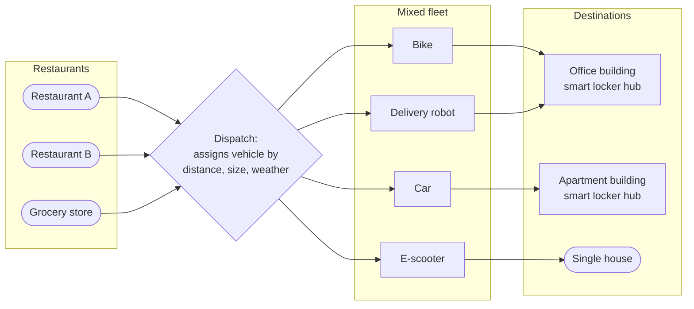
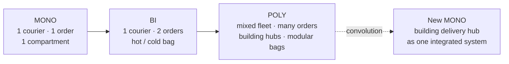

# Mono – Bi – Poly: Food Delivery Unit

## 1. System for Analysis (Mono-system)

**System:** The delivery unit - **one courier** carrying **one order** in **one insulated bag** from a restaurant to a customer.

| Property | Mono-system |
|---|---|
| Couriers | 1 |
| Orders per trip | 1 |
| Bag compartments | 1 (everything at the same temperature) |
| Return trip | Empty |

**Limitations:**

- One trip serves only one customer, so the cost per order is high
- Hot food and cold items (drinks, desserts) share one space and affect each other's temperature
- The courier travels back empty

---

## 2. Bi-system

### Variants

| Type of bi-system | Transformation | Benefits |
|---|---|---|
| **Homogeneous** (two identical elements) | One courier carries **two orders** going in the same direction | Fewer trips; lower cost per order; more income per hour for the courier |
| **Shifted characteristics** (two similar elements with different parameters) | Bag with **two compartments: hot and cold** | Hot meals stay hot and cold items stay cold; better food quality; desserts and drinks can be delivered with meals |
| **Inverse** (system + anti-system) | Delivery + collection on the same trip (Task 5) | No empty return trips; reusable packaging becomes possible |

### Selected bi-system: two-order delivery with a hot/cold bag

One courier carries **two orders** to nearby addresses in a **two-compartment bag**.

**Benefits:**

| Benefit | For whom |
|---|---|
| Delivery cost per order is lower | Platform, customer |
| More orders delivered per hour | Courier (income), platform |
| Hot and cold items each kept at the right temperature | Customer, restaurant (quality reputation) |
| Fewer vehicles on the road per order | City, environment |

**New problem created:** The second customer waits longer - the same delay defect found in Task 2.
**Resolution:** Combine only orders whose addresses are close and whose total added delay stays within the delivery time limit.

---

## 3. Poly-system

### Variants

| Type of poly-system | Transformation | Benefits |
|---|---|---|
| **Homogeneous** | **Building batch**: many orders for the same office or apartment building are delivered together to a smart locker in the lobby | One trip serves many customers; no waiting at each door; solves the "last 50 metres" problem (Task 4) |
| **Heterogeneous** (different elements) | **Mixed fleet**: bikes, e-scooters, cars and delivery robots, each assigned by distance, order size and weather | The right vehicle for each job; robots handle short routine trips; cars handle large or distant orders; delivery continues in bad weather |
| **Shifted characteristics** | **Modular bag** with several compartments: hot, warm, chilled, frozen, and a sealed section for collected containers | Any mix of items - meals, groceries, ice cream, returns - in one trip at the correct temperature |

### Selected poly-system: mixed fleet with building hubs

**Benefits:**

| Benefit | Explanation |
|---|---|
| **Lower cost per order** | One trip to a building hub serves many customers |
| **Flexibility** | Each order gets the most suitable vehicle |
| **Resilience** | If one vehicle type cannot operate (e.g., robots in snow), others take over |
| **Better quality** | Modular, multi-temperature compartments suit any combination of items |
| **Less waiting for customers** | Orders wait safely in the locker; customers collect them when ready |
| **Less traffic and emissions** | Fewer, fuller trips; small electric vehicles for short distances |

---

## 4. Evolution Summary

Following the TRIZ trend, the poly-system can **fold back into a new mono-system**: the building delivery hub becomes a single integrated element that receives, stores and keeps food at the right temperature for everyone in the building. This connects to level 2 of the ideal system in Task 9.

