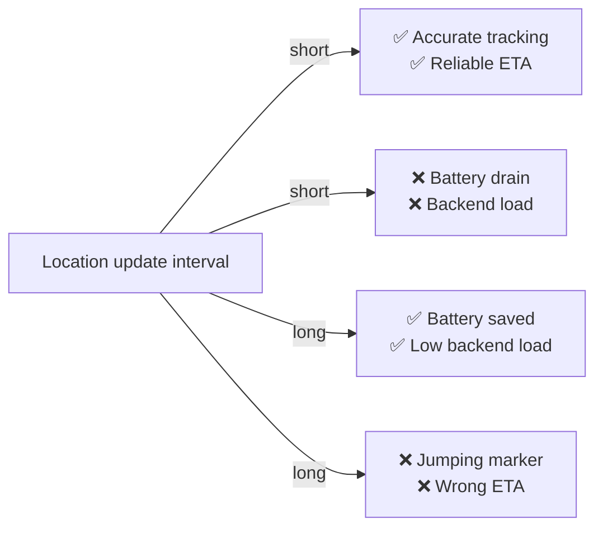

# Contradiction: Live Courier Tracking

## 1. Software System and Goal of Improvement

**Software system:** Online food delivery platform - the **live order tracking** feature (courier app -> tracking backend -> customer app).

**Current situation:** The courier app sends its GPS location to the backend **every 30 seconds**. On the customer's map, the courier marker "jumps" between positions, and the ETA can be off by several minutes.

**Goal of improvement:** Make live tracking **accurate and smooth**, so the customer sees exactly where the courier is and gets a reliable ETA. Fewer "where is my order?" support requests.

---

## 2. Element to Be Changed

**Element:** The **location update interval** in the courier app.

| | Current | Proposed |
|---|---|---|
| Location update interval | 30 seconds | 2 seconds |

---

## 3. Negative Effect of the Change

Sending location 15 times more often causes:

| Negative effect | Who is affected |
|---|---|
| **Faster battery drain** - GPS and network radio stay active almost constantly | Courier: the phone can die mid-shift, and without the app they cannot work |
| **More mobile data used** | Courier (data plan costs) |
| **Much higher backend load** - 15× more location messages from thousands of couriers at peak | Platform: higher infrastructure cost, risk of slowing down other services |

---

## 4. Contradiction

> **If we** reduce the courier app's location update interval from 30 seconds to 2 seconds,
> **then we** give customers accurate, smooth live tracking and a reliable ETA,
> **but this leads to** fast battery drain on couriers' phones and a large increase in backend load and cost.

### Technical contradiction

| Improving parameter | Worsening parameters |
|---|---|
| Tracking accuracy | Courier phone energy use, backend load |

### Physical contradiction (deeper form)

> The location update interval must be **short** to give accurate tracking, **and long** to save battery and backend capacity.

---

## Possible Resolution (separation principles)

| Separation | Idea |
|---|---|
| **In time** | Update rarely while the courier waits at the restaurant; update often only in the last minutes before arrival, when the customer is actually watching |
| **By condition** | Send updates more often when the courier is moving fast or changes direction, rarely when stopped |
| **In space** | Keep precise position data on the phone; send only key points, and let the customer app smooth the movement between them along the known route |

These let the interval be **short when it matters and long when it doesn't**, which resolves the contradiction instead of choosing a compromise value.

