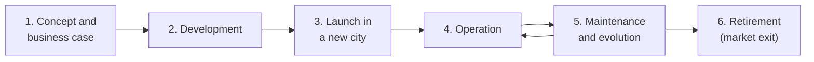

# Stakeholders: Online Food Delivery Platform

## 1. System for Analysis

**System:** Online food delivery platform (e.g., Wolt / Bolt Food) - customer app, restaurant app, courier app and backend.

---

## 2. Life-Cycle Stages

| # | Stage | What happens |
|---|---|---|
| 1 | **Concept and business case** | Idea, market research, funding, business model |
| 2 | **Development** | Design, build and test the apps and backend |
| 3 | **Launch in a new city** | Onboard restaurants, recruit couriers, attract first customers |
| 4 | **Operation** | Daily ordering, delivery and payments |
| 5 | **Maintenance and evolution** | Fix defects, add features, keep security and compliance up to date |
| 6 | **Retirement (market exit)** | Shut down the service in a market, or merge it into another product |

---

## 3–4. Super-system and Stakeholders for Each Stage

### Stage 1: Concept and business case

**Super-system:** The **business and investment environment** - market, competitors and funding.

| Stakeholder | Interest |
|---|---|
| Founders / company management | A viable business model |
| Investors | Return on investment, growth |
| Potential customers | Convenient access to food |
| Competitors (other platforms) | Defend their market share |
| Market regulators | Fair competition |

### Stage 2: Development

**Super-system:** The **software development organisation** and its technology suppliers.

| Stakeholder | Interest |
|---|---|
| Product managers | Features that match user needs |
| UX/UI designers | Usable, clear interfaces |
| Software developers | Clear requirements, maintainable code |
| QA engineers | Testable, stable software |
| Third-party API providers (maps, payments, SMS) | Correct use of their services, paid usage |
| Cloud provider | Infrastructure contract |

### Stage 3: Launch in a new city

**Super-system:** The **local market of the new city**.

| Stakeholder | Interest |
|---|---|
| Local restaurants | New sales channel at acceptable commission |
| Couriers (new recruits) | Flexible income |
| Early customers | Good offers, reliable delivery |
| Local authorities / municipality | Business registration, traffic and public space rules |
| Marketing and partner teams | Fast growth in the new market |

### Stage 4: Operation

**Super-system:** The **urban food service ecosystem** (Task 3).

| Stakeholder | Interest |
|---|---|
| Customers | Fast, hot, affordable meals |
| Restaurants | More orders, fair commission |
| Couriers | Stable income, safe working conditions |
| Payment providers | Correct, secure transactions |
| Customer support team | Few and easily resolvable issues |
| DevOps / SRE engineers | Stable, available system |
| Food safety, labour and tax authorities | Compliance with regulations |
| City residents | Low traffic, noise and packaging waste |

### Stage 5: Maintenance and evolution

**Super-system:** The **product organisation and its legal / security environment**.

| Stakeholder | Interest |
|---|---|
| Product and engineering teams | Improve the product, reduce technical debt |
| Data analysts | Reliable data for decisions |
| Security team | Protect user data and payments |
| Data protection authority (GDPR) | Lawful handling of personal data |
| App stores (Apple, Google) | Compliance with store policies |
| Existing users (customers, restaurants, couriers) | Improvements without breaking familiar flows |

### Stage 6: Retirement (market exit)

**Super-system:** The **legal and contractual environment** of shutting down a service.

| Stakeholder | Interest |
|---|---|
| Customers | Refunds, export or deletion of personal data |
| Restaurants | Notice period, final payouts, alternative channel |
| Couriers | Final earnings, notice in time to find other work |
| Employees in the market | Job transfer or fair termination |
| Data protection authority | Correct deletion and retention of data |
| Acquirer / competitor (if any) | Taking over customers and partners |

---

## 5. Consolidated List of Stakeholders

| # | Stakeholder | Type | 1 Concept | 2 Dev | 3 Launch | 4 Ops | 5 Maint. | 6 Retire |
|---|---|---|:-:|:-:|:-:|:-:|:-:|:-:|
| 1 | Customers | External | X | | X | X | X | X |
| 2 | Restaurants | External | | | X | X | X | X |
| 3 | Couriers | External | | | X | X | X | X |
| 4 | Founders / management | Internal | X | | | | | X |
| 5 | Investors | External | X | | | | | X |
| 6 | Competitors | External | X | | | | | X |
| 7 | Product managers | Internal | | X | | | X | |
| 8 | UX/UI designers | Internal | | X | | | X | |
| 9 | Software developers | Internal | | X | | | X | |
| 10 | QA engineers | Internal | | X | | | X | |
| 11 | DevOps / SRE engineers | Internal | | | | X | X | |
| 12 | Security team | Internal | | | | | X | |
| 13 | Data analysts | Internal | | | | | X | |
| 14 | Customer support team | Internal | | | | X | | |
| 15 | Marketing and partner teams | Internal | | | X | | | |
| 16 | Employees (general) | Internal | | | | | | X |
| 17 | Third-party API providers | External | | X | | X | | |
| 18 | Cloud provider | External | | X | | X | | |
| 19 | Payment providers | External | | | | X | | |
| 20 | App stores | External | | | | | X | |
| 21 | Market / competition regulators | External | X | | | | | |
| 22 | Local authorities / municipality | External | | | X | | | |
| 23 | Food safety, labour and tax authorities | External | | | | X | | |
| 24 | Data protection authority | External | | | | | X | X |
| 25 | City residents | External | | | | X | | |
| 26 | Acquirer (if any) | External | | | | | | X |

**Observations:**

- **Customers, restaurants and couriers** are present in almost every stage - they are the core stakeholders of the platform.
- Most **internal** stakeholders appear in development and maintenance; most **regulators** appear when the system meets the real world (launch, operation, retirement).
- Some stakeholders are only visible in a single stage (e.g., city residents in operation, acquirer in retirement). Analysing only the operation stage would miss them.

