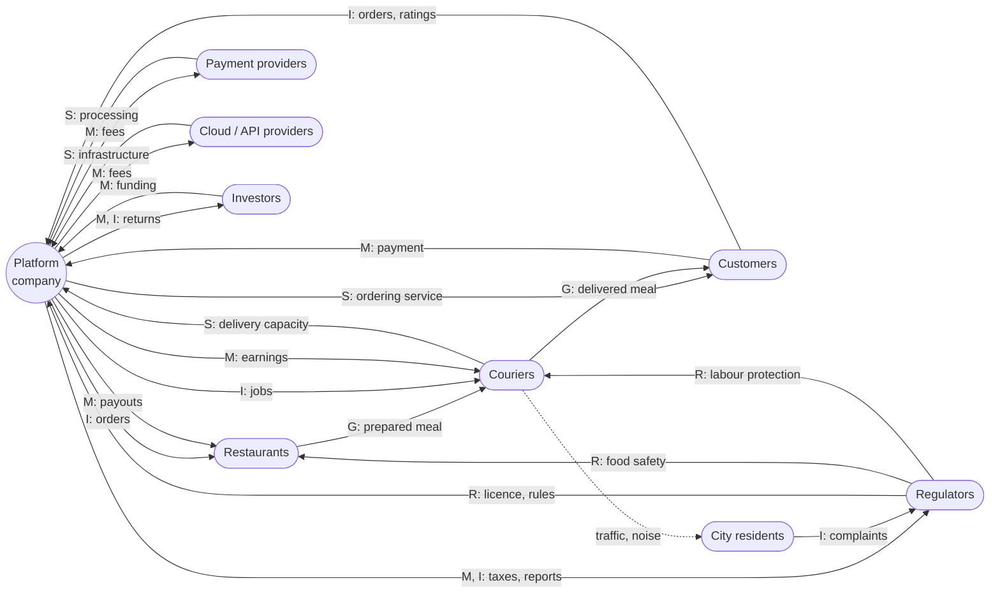
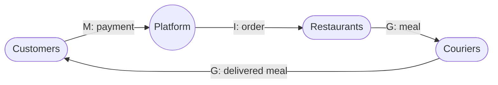

# Stakeholder Value Network: Online Food Delivery Platform

## 1. Selected Stakeholders

From the consolidated list in Task 12, the stakeholders with the strongest value exchanges during **operation**:

| # | Stakeholder | Role in the network |
|---|---|---|
| 0 | **Platform company** | Focal organisation - connects all others |
| 1 | **Customers** | Create demand and pay |
| 2 | **Restaurants** | Supply food |
| 3 | **Couriers** | Supply delivery capacity |
| 4 | **Payment providers** | Process payments |
| 5 | **Cloud and API providers** | Supply infrastructure, maps, SMS |
| 6 | **Investors** | Supply funding |
| 7 | **Regulators** (food safety, labour, tax, data protection) | Set rules, collect taxes |
| 8 | **City residents** | Share the streets with delivery traffic |

---

## 2. Relations Between Stakeholders

### Types of value flow

| Code | Type | Example |
|---|---|---|
| **M** | Money | Payments, commissions, wages, fees |
| **G** | Goods | Physical meals |
| **S** | Service | Delivery, infrastructure, payment processing |
| **I** | Information | Orders, ratings, data |
| **R** | Regulation | Rules, licences, protection |

### Value flows

| # | From | To | Value | Type |
|---|---|---|---|---|
| 1 | Customers | Platform | Payment for order and delivery fee | M |
| 2 | Customers | Platform | Orders, ratings, usage data | I |
| 3 | Platform | Customers | Ordering, tracking and support service | S |
| 4 | Platform | Restaurants | Orders from new customers | I |
| 5 | Platform | Restaurants | Payout for sold food (minus commission) | M |
| 6 | Restaurants | Couriers | Prepared meal for pickup | G |
| 7 | Couriers | Customers | Delivered meal | G |
| 8 | Platform | Couriers | Delivery jobs and routes | I |
| 9 | Platform | Couriers | Earnings per delivery | M |
| 10 | Couriers | Platform | Delivery capacity | S |
| 11 | Payment providers | Platform | Payment processing | S |
| 12 | Platform | Payment providers | Transaction fees | M |
| 13 | Cloud and API providers | Platform | Hosting, maps, notifications | S |
| 14 | Platform | Cloud and API providers | Usage fees | M |
| 15 | Investors | Platform | Funding | M |
| 16 | Platform | Investors | Returns and growth reports | M, I |
| 17 | Regulators | Platform | Rules and licence to operate | R |
| 18 | Platform | Regulators | Taxes and compliance reports | M, I |
| 19 | Regulators | Restaurants | Food safety rules | R |
| 20 | Regulators | Couriers | Labour protection | R |
| 21 | Couriers | City residents | Traffic, noise *(negative externality)* | - |
| 22 | City residents | Regulators | Complaints and political pressure | I |

---

## 3. Stakeholder Value Network

*Dashed line = negative effect.*

---

## Key Value Loops

A value loop is a chain of flows that returns to its starting stakeholder. Loops show **why each stakeholder stays in the network**.

### Loop 1 - Core commerce loop

The customer's money turns into a meal at their door. This is the reason the network exists.

### Loop 2 - Courier loop

**Platform** --> *jobs* --> **Couriers** --> *delivery capacity* --> **Platform** --> *service* --> **Customers** --> *payment* --> **Platform** --> *earnings* --> **Couriers**

Couriers stay only while earnings are worth their time; without them the core loop breaks.

### Loop 3 - Investment loop

**Investors** --> *funding* --> **Platform** --> *service* --> **Customers** --> *payment* --> **Platform** --> *returns* --> **Investors**

Investors fund growth as long as the customer loop produces revenue.

### Loop 4 - Regulatory loop

**Couriers** --> *traffic, noise* --> **City residents** --> *complaints* --> **Regulators** --> *rules* --> **Platform** --> *changes to courier operations* --> **Couriers**

A negative effect on one stakeholder comes back to the platform as regulation.

---

## Observations

- The **platform is a broker**: almost every flow passes through it, and it produces no food or transport itself.
- **Customers, restaurants and couriers** form the core loop; each one can break the network by leaving.
- The **regulatory loop** shows why stakeholders who never use the app (city residents) still matter. Their pressure reaches the platform through regulators.

